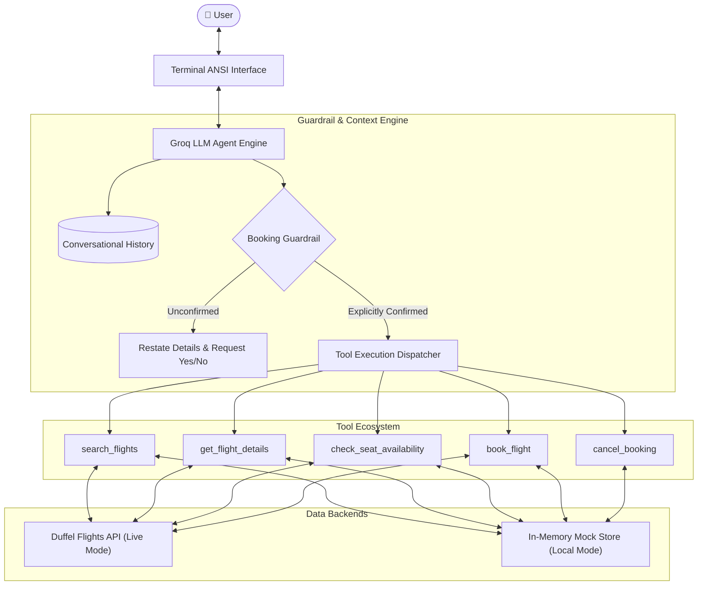

# ✈️ AI Flight Concierge & Booking Agent

An intelligent, conversational flight booking assistant powered by **Llama-3 / GPT-OSS models via Groq** and live **Duffel Airline API** integration. Built with strict **two-phase confirmation guardrails**, multi-turn conversational memory, intelligent IATA code resolution, and automated inventory management.

---

## 🌟 Key Features

- **🛫 Dual Flight Data Modes:**
  - **Live GDS Mode (`duffel_flight_agent.py`):** Live airline flight searches and real-time offer requests via the **Duffel API**.
  - **Local Mock Mode (`flight_booking_agent.py`):** In-memory flight database with instant local seat inventory deduction and booking state tracking.
- **🛡️ Strict Booking Guardrail (Two-Phase Confirmation):**
  - The agent is programmatically and prompt-constrained **never** to invoke `book_flight` on the initial turn.
  - Automatically verifies seat availability $\to$ restates all flight details (flight ID, dates, times, passenger count, total fare) $\to$ requires an explicit confirmation reply before tool execution.
- **🧠 Multi-Turn Conversational Memory & Coreference Resolution:**
  - Maintains full dialogue history across turns.
  - Resolves indirect references like *"What is the departure time for the second one?"* or *"Book it for 2 passengers"*.
- **🌐 Smart IATA & City Resolution:**
  - Maps common metropolitan and airport names (e.g., Delhi, NYC, London Heathrow, Mumbai, Tokyo) to official 3-letter IATA codes (`DEL`, `JFK`, `LHR`, `BOM`, `HND`).
- **🔄 Booking Cancellation & Seat Restoration:**
  - Handles cancellation requests with booking reference lookup, restoring passenger seat counts back to available inventory.
- **🎨 Modern Terminal UI:**
  - Formatted ANSI terminal interface with styled banners, conversation badges, and clear error extraction.

---

## 🏛️ System Architecture



---

## 🛠️ Tool Specifications

| Tool Name | Parameters | Description |
| :--- | :--- | :--- |
| `search_flights` | `origin`, `destination`, `date`, `num_passengers` | Searches available flights/offers between cities on a specified date. |
| `get_flight_details`| `flight_id` / `offer_id` | Fetches full flight specifics (exact departure/arrival times, pricing, airline). |
| `check_seat_availability` | `flight_id` / `offer_id`, `passengers` | Verifies whether the selected flight has sufficient remaining seats. |
| `book_flight` | `flight_id`, `passenger_name`, `passengers` | Generates a unique booking reference and confirms the reservation (**only called after explicit user confirmation**). |
| `cancel_booking` | `booking_reference` | Cancels an existing booking and restores reserved seats back to the inventory. |

---

## 📂 Project Structure

```text
Flight_Booking_Agent/
├── README.md                 # Project documentation and architecture
├── duffel_flight_agent.py    # Live airline booking agent (Duffel API + Groq LLM)
├── flight_booking_agent.py   # Self-contained agent with local mock data & state tracking
├── list_models.py            # Utility script to inspect available Gemini/Groq models
├── transcript.txt            # Sample multi-turn conversation transcript
├── powershell.cmd            # Local Windows environment runner wrapper
└── .gitignore                # Git exclusions (API keys, bytecode, virtual envs)
```

---

## 🚀 Getting Started

### 1. Prerequisites
- Python 3.9+
- A free **Groq API Key** from [console.groq.com](https://console.groq.com)
- *(Optional for Live Mode)* A **Duffel Access Token** from [duffel.com](https://duffel.com)

### 2. Installation
```bash
git clone https://github.com/PrachiSahoo/flight_booking_agent.git
cd flight_booking_agent
pip install requests
```

### 3. Environment Variables
Set your credentials in your shell or terminal:

**Windows (PowerShell):**
```powershell
$env:GROQ_API_KEY = "gsk_your_groq_api_key_here"
$env:DUFFEL_ACCESS_TOKEN = "duffel_test_your_token_here" # Optional for live mode
```

**macOS / Linux:**
```bash
export GROQ_API_KEY="gsk_your_groq_api_key_here"
export DUFFEL_ACCESS_TOKEN="duffel_test_your_token_here"
```

### 4. Running the Agent

**Run Live Duffel API Agent:**
```bash
python duffel_flight_agent.py
```

**Run Local In-Memory Mock Agent:**
```bash
python flight_booking_agent.py
```

---

## 💬 Example Interaction

```text
╭───────────────────────────────────────────────────────────────────╮
│  ✈  FLIGHT CONCIERGE AI · Booking Assistant                       │
│     Smart Flight Search · Booking Confirmation · Cancellation     │
│     Type 'exit' or 'quit' anytime to end session                  │
╰───────────────────────────────────────────────────────────────────╯

👤 You ❯ Find me flights from Delhi to Mumbai on 2026-09-10

✈️  Agent
│  I found 2 available flights from Delhi to Mumbai on 2026-09-10:
│  1. Flight AI101: 06:00 to 08:15, Price: 4500 INR
│  2. Flight UK303: 18:00 to 20:15, Price: 5200 INR

👤 You ❯ What's the departure time for the second one?

✈️  Agent
│  The second flight is Flight UK303:
│  - Departure Time: 18:00 (Arrival: 20:15)
│  - Price: 5200 INR per seat

👤 You ❯ Book it for 2 passengers under name Aditi Sharma

✈️  Agent
│  I have verified availability: Flight UK303 has 6 seats available.
│  Before I proceed, please confirm the following reservation details:
│  - Flight ID: UK303 (Delhi -> Mumbai)
│  - Date: 2026-09-10 (18:00 - 20:15)
│  - Passengers: 2 (Aditi Sharma)
│  - Total Fare: 10,400 INR
│  
│  Do you confirm this booking? (Yes/No)

👤 You ❯ Yes, confirm

✈️  Agent
│  Booking confirmed! Reference: 9A2B4C6D.
│  Flight UK303 successfully booked for 2 passenger(s) under 'Aditi Sharma'.
```

---

## 🛡️ Edge Cases Handled

1. **Zero-Seat Flights Excluded from Search:**
   Flights with `seats_available <= 0` are excluded from user-facing search results, preventing users from attempting to select unavailable flights.
2. **Deterministic Fallbacks:**
   If the user enters a non-existent city or an unsupported airport route, the agent returns an explicit error message rather than hallucinating routes.
3. **Model Fallback Chain:**
   The native agent engine automatically attempts configured fallback models (`openai/gpt-oss-120b`, `openai/gpt-oss-20b`) if rate-limiting or latency thresholds occur.

---

## 📄 License
MIT License. Open-source for personal and educational use.
